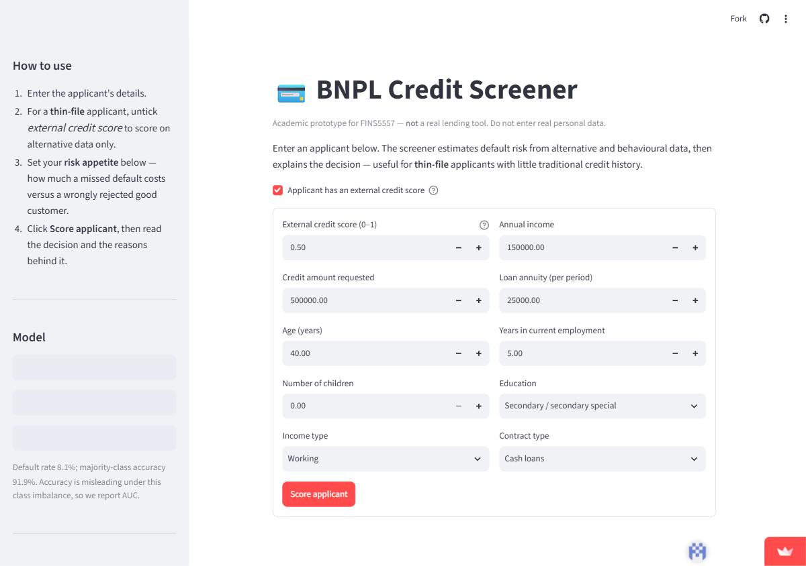
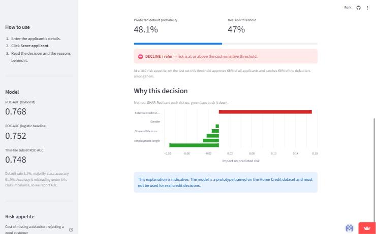
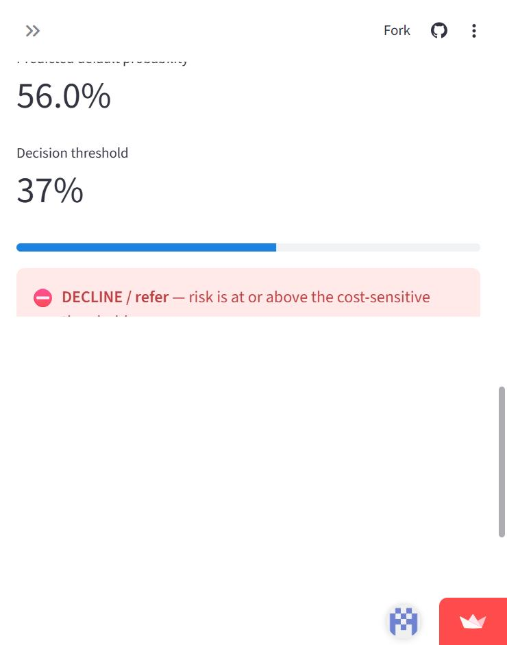
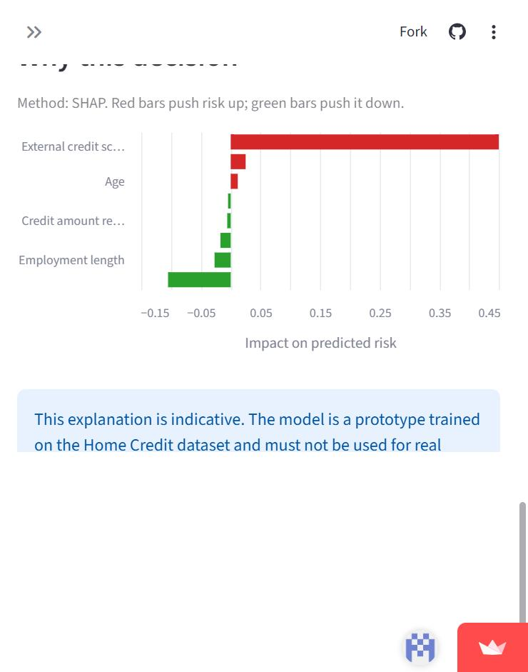

# BNPL Credit Screener

An academic prototype for **FINS5557 Applied AI in Finance** (Track A).
It scores the default risk of **thin-file** Buy-Now-Pay-Later applicants with a
gradient-boosting model and explains every decision, so a risk officer sees not
just a score but *why*.

**🔗 Live app:** https://bnpl-credit-screener-vttjmky8hvvkrijh7zl3tt.streamlit.app

> ⚠️ **Prototype only — not a real lending tool.** Do not enter real personal
> data. Decisions are illustrative and must not be used for actual credit calls.

## Features

- Default-risk score for a single applicant from an easy input form.
- **Three models trained and compared** against a majority-class baseline:
  an interpretable **Logistic Regression**, a **Random Forest**, and an
  **XGBoost** gradient-boosting main model. (If `xgboost` is not installed the
  pipeline falls back to scikit-learn's HistGradientBoosting, the same
  algorithm, so the code runs anywhere.)
- **Feature engineering** on top of the raw table: credit/income and
  annuity/income ratios, loan term, and external-score aggregates (mean, min,
  max, and a count of how many external scores are present — the thin-file
  signal).
- **Thin-file focus**: performance is reported separately on the thin-file
  subset (applicants with at most one external credit score), the population
  the screener is meant to serve.
- **Thin-file mode**: a toggle to score an applicant with *no* external credit
  score, on alternative and behavioural data only — the core use case.
- **Protected attributes excluded**: gender and marital/family status are left
  out of the model inputs, so a legally protected characteristic is never used in
  a decision.
- **Probability calibration**: the gradient-boosting scores are isotonic-calibrated
  on a validation split, so the probability shown is on the same scale as the
  decision threshold.
- **Per-decision explanation** (SHAP when installed; a model-agnostic local
  fallback otherwise), tied to the applicant's own inputs. The three bureau
  scores and their summary stats are collapsed into one "external credit score"
  contribution, so the chart shows one clear signal instead of several
  near-duplicate (and sometimes contradictory) bars.
- A **cost-sensitive decision threshold** (a missed defaulter costs more than a
  wrongly rejected good applicant), not a naive 0.5 cut-off.
- A **risk-appetite slider**: the user sets the cost ratio (missing a defaulter
  vs. rejecting a good customer) and the threshold re-tunes live, using a
  cost-ratio→threshold grid precomputed at training time (for the full
  population and the thin-file regime separately).
- **Evaluation figures** generated at training time (ROC, precision-recall,
  confusion matrix for the full population and for thin-file mode, calibration
  before/after, permutation importance) saved to `figures/`.
- Input validation and graceful error handling.

## Project structure

```
bnpl-credit-screener/
├── app.py              # Streamlit app (UI, scoring, explanation)
├── requirements.txt
├── .gitignore          # excludes data + .env
├── .env.example
├── src/
│   ├── config.py       # paths, exposed input features, cost ratio
│   ├── features.py     # feature engineering (shared by training + app)
│   ├── train.py        # trains 3 models, evaluates, saves artifacts + figures
│   └── predict.py      # load artifacts, score, explain
├── models/             # trained artifacts (committed so the app runs)
├── figures/            # evaluation figures from the last training run
└── data/               # dataset goes here — NOT committed
```

## Dataset

Home Credit Default Risk (Kaggle).
<https://www.kaggle.com/competitions/home-credit-default-risk/data>

The dataset is **not** included in this repository — Kaggle's competition rules
do not allow redistribution, and the files are large. To reproduce:

1. Download from Kaggle (needs a Kaggle account; accept the competition rules).
2. Unzip `application_train.csv` into `data/`.

This prototype uses only the main `application_train.csv` table
(307,511 rows, 122 columns). Joining the auxiliary tables (bureau, previous
applications, etc.) is a planned improvement.

## Installation

```bash
python -m venv .venv && source .venv/bin/activate   # Windows: .venv\Scripts\activate
pip install -r requirements.txt
```

## Usage

**1. Train the models** (writes artifacts to `models/`):

```bash
python -m src.train --data data/application_train.csv
```

**2. Run the app:**

```bash
streamlit run app.py
```

Open the local URL Streamlit prints, fill in the applicant form, and click
**Score applicant**. You get a default probability, an approve / decline
decision against the cost-sensitive threshold, and a ranked explanation of the
features driving that applicant's score.

### Screenshots

**Main screen** — input form, with model metrics and the risk-appetite slider in
the sidebar:



**A scored decision** — predicted default probability, the cost-sensitive
threshold, the approve / decline call, and a SHAP explanation (the external-score
family shown as a single contribution):



**Thin-file mode** — the same applicant with the external-score switch off. The
model scores on alternative data only and uses the thin-file threshold; the
explanation labels the missing external score and surfaces the behavioural
features instead:





### Worked example

With the risk appetite at 10:1, the app compares the applicant's **calibrated**
default probability against a decision threshold of about 0.09 and returns an
**APPROVE** or **DECLINE / refer** call. Lowering the risk appetite (e.g. 5:1)
raises the threshold, so more borderline cases are approved; turning the
external-score switch off scores the same person as a thin-file applicant on
alternative data only, using the thin-file threshold (about 0.08).

## API key setup (optional LLM explanation layer)

If you add the optional plain-language explanation layer, keys are read from a
local `.env` file (see `.env.example`) — **never hard-coded**:

```
OPENAI_API_KEY=sk-...
```

On Streamlit Cloud, set the same values under **App → Settings → Secrets**
instead of committing them.

## Deployment (public URL)

**Live app:** https://bnpl-credit-screener-vttjmky8hvvkrijh7zl3tt.streamlit.app

1. Push this repo to **public GitHub**.
2. On [Streamlit Community Cloud](https://streamlit.io/cloud), create an app
   pointing at `app.py`.
3. Add any secrets under App → Settings → Secrets.

## Results (held-out test set)

| Model | ROC-AUC | PR-AUC |
|---|---|---|
| Logistic Regression | 0.755 | 0.233 |
| Random Forest | 0.749 | 0.234 |
| **XGBoost (gradient boosting)** | **0.764** | **0.251** |
| Baseline (majority class) | 0.500 | 0.081 |

Models are trained on a stratified **60/20/20 train / validation / test split**:
thresholds and the probability calibrator are chosen on the validation set, and
every number here is measured on the untouched test set. Default rate is 8.1%,
so majority-class accuracy is 91.9% — which is why we use AUC, not accuracy. On
the **thin-file subset** (12% of applicants, 9.4% default rate) AUC is 0.746
versus 0.765 on the rest, showing thin-file applicants are genuinely harder to
score — the problem this tool targets. The model is isotonic-calibrated on the
validation split (Brier score 0.169 → 0.068), and the app serves the calibrated
probability. Protected attributes (gender and marital/family status) are
deliberately excluded from the model inputs.

## Performance

The trained XGBoost model and preprocessing pipeline are loaded **once** and
cached with Streamlit's `@st.cache_resource` (see `get_artifacts()` in
`app.py`). Streamlit reruns the whole script on every widget change, so without
caching the model would be deserialised from disk on each interaction. Caching
keeps a single copy in memory, shared across reruns and users, so each click
only runs inference — not a reload — which removes the main source of latency in
the app.

The app also gives visual feedback for every processing state: a spinner while
the model loads, a spinner while scoring and while computing the explanation,
and clear success / decline / error banners.

## Known issues & planned improvements

- Uses only the main application table; AUC (~0.77) should rise after joining
  the bureau / previous-application tables.
- The cost ratio defaults to 10:1 and is adjustable in-app (5:1–15:1); the range
  is grounded in rough BNPL unit economics but should be calibrated with a
  lender's real loss data.
- The single external-score input maps to all three bureau-score features, so in
  the app they are perfectly correlated; the explanation groups them to avoid
  misleading per-feature attributions, but a future version could expose the
  three scores (and behavioural bureau features) separately.
- SHAP explanations are computed per request and can be slow on the free tier.

## AI tool disclosure

Generative AI (Claude Code) was used as a coding and drafting assistant on these
tasks: scaffolding the repository; writing and refactoring the training,
feature-engineering, prediction and Streamlit-app code; debugging the
Colab/Streamlit dependency-version mismatch; designing the cost-ratio grid and
risk-appetite slider; diagnosing and fixing the SHAP multicollinearity in the
explanation. All AI-assisted output was reviewed,
tested and revised by the team, which is responsible for the final content.

## Attribution

- Data: Home Credit Default Risk, Kaggle.
- Libraries: scikit-learn, SHAP, Streamlit, pandas, NumPy.
